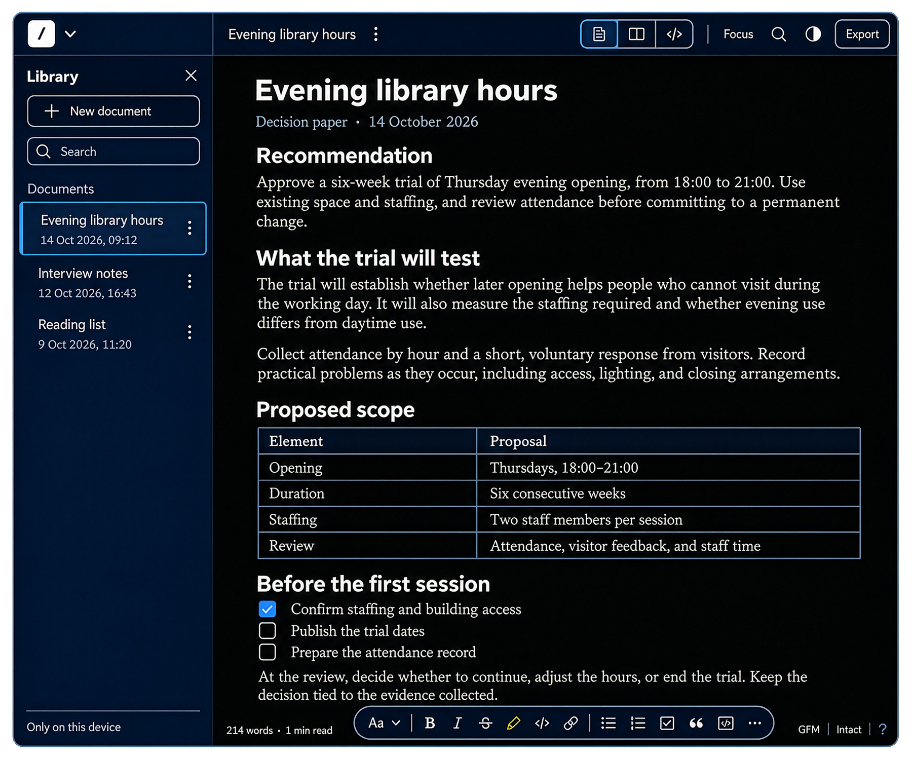

  

<h1 align="center">Notedown</h1>

  An advanced word processor for intuitive writing.

  <a href="docs/product-overview.md">Product overview</a> ·
  <a href="docs/formats.md">Formats</a> ·
  <a href="docs/roadmap.md">Roadmap</a> ·
  <a href="https://github.com/yasirdora/notedown/issues">Feedback</a>

  

## Write, format, and organize documents

Notedown combines visual document editing, formatting, and organization in a
browser-based word processor. Draft a project brief, structure a research
note, or prepare meeting notes with headings, tables, images, and footnotes.
Edit the formatted document, work directly in Markdown, or view both together.

Documents are stored as Markdown in a library in your browser. Export them to
keep a backup or continue working in another application. Notedown has no
account system or built-in cloud sync.

## Features

- **Edit and read.** Page, Markdown, Split, and Read views, with light, dark,
  and system themes.
- **Format documents.** Headings, lists, tasks, tables, quotes, links,
  images, fenced code, and optional footnotes.
- **Organize and navigate.** A document library, search, an outline, and
  section reordering.
- **Use keyboard commands.** Slash insertion, a command palette, and formatting
  shortcuts.
- **Review page edits.** Versions compares your document with a trusted
  Markdown baseline and lets you restore that baseline.
- **Export and copy.** Markdown and HTML export, browser printing to
  PDF, and copy formats for Slack, Docs, email, and plain text.

See the [product overview](docs/product-overview.md) for editing tools
and the [format guide](docs/formats.md) for compatibility and export limits.

## Storage and offline use

Documents and preferences use browser storage; pasted and dropped images are
stored separately in the browser. The current app has no document
upload service or analytics integration. Offline use is available after the
application has loaded and its files have been cached.

Browser storage can be cleared. Remote images can contact their hosts and may
be unavailable offline. A Markdown export does not bundle locally stored
images; HTML export embeds available local images. Keep exports of important
work. The [privacy and storage guide](docs/privacy-and-storage.md) explains
storage, network requests, and backup options.

## Status

Notedown is in development as a browser application. This repository documents
the current implementation; it does not distribute the application or announce
a public release. Native applications and cross-device collaboration are not
part of the current implementation.

The [roadmap](docs/roadmap.md) separates implemented capabilities from work
under consideration.

## Example documents

The [examples](examples/README.md) are small, original Markdown documents you
can read here or use in Notedown:

- [Evening library hours](examples/evening-library-hours.md) — the decision paper shown above, with a scope table and tasks.
- [Meeting notes](examples/meeting-notes.md) — decisions, tasks, and a table.
- [Project brief](examples/project-brief.md) — an objective, deliverables, and acceptance criteria.
- [Research note](examples/research-note.md) — optional footnotes.

## Documentation

| Guide | What it covers |
|---|---|
| [Product overview](docs/product-overview.md) | Editing, formatting, organization, and export |
| [Design principles](docs/design-principles.md) | The decisions behind the product |
| [Formats](docs/formats.md) | Markdown, images, import, export, and portability |
| [Privacy and storage](docs/privacy-and-storage.md) | Local data, offline use, and backups |
| [FAQ](docs/faq.md) | Common questions and current limits |
| [Roadmap](docs/roadmap.md) | Current capabilities and possible next steps |
| [Development record](record/README.md) | A retrospective account of the work |
| [Changelog](CHANGELOG.md) | Changes to this public repository |

## Feedback and contributions

Report a reproducible problem or suggest an improvement through
[Issues](https://github.com/yasirdora/notedown/issues). Documentation corrections
and small, non-sensitive examples are welcome. Read
[CONTRIBUTING.md](CONTRIBUTING.md) before submitting a report or pull request.
Please report vulnerabilities privately using the process in
[SECURITY.md](SECURITY.md).

## This repository

This is Notedown's public product repository. It contains documentation,
examples, product images, and checks for those materials. Application source,
internal research, and private development notes remain separate. There is no
application build to run from this repository.

The documentation history is reconstructed; its dates are not release dates.
See the [development record](record/README.md) for provenance.

## Licence

Copyright © 2026 Yasir Dora. All rights reserved.
The public materials are proprietary; see [LICENSE](LICENSE) for permissions.
